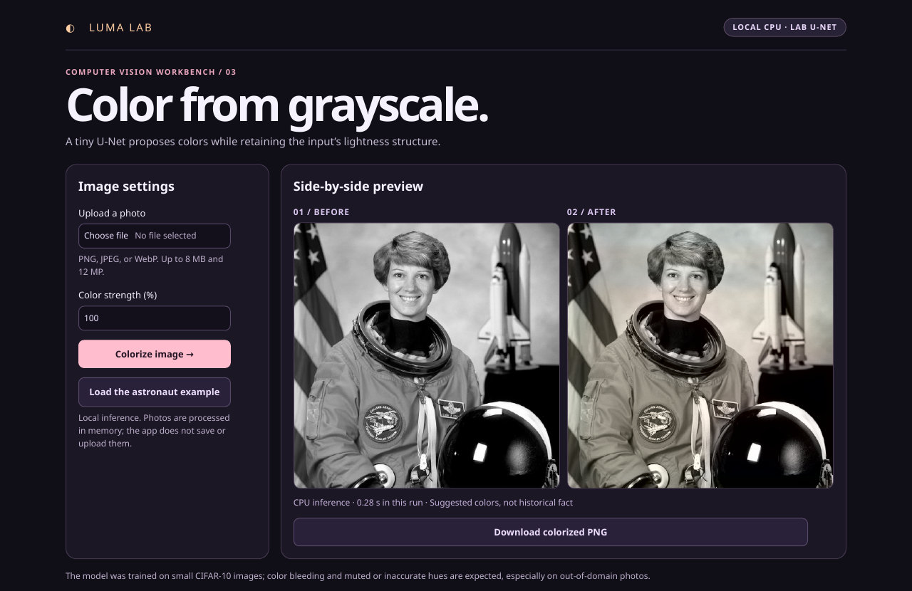

# Luma Lab | CNN Image Colorizer

A local Python photo-colorization app with a side-by-side preview, adjustable color strength, and PNG export. This AI-assisted portfolio project independently implements the supplied Colab project's one-level skip U-Net design. It ships with a separately trained checkpoint; it does not contain the reference notebook or its images and does not claim to reproduce its results.



*Desktop preview rendered from the app's HTML and real CPU inference. This is not a reconstructed original color image.* [Mobile preview](gui-mobile.jpg).

## Run on Windows

Install [Python 3.12](https://www.python.org/downloads/) first. From the cloned repository in PowerShell:

```powershell
git clone https://github.com/vivek1432ps/bw-colorization-cnn.git
cd bw-colorization-cnn
py -3.12 -m venv .venv
.\.venv\Scripts\python.exe -m pip install torch==2.7.1 --index-url https://download.pytorch.org/whl/cpu
.\.venv\Scripts\python.exe -m pip install -r requirements.txt
.\.venv\Scripts\python.exe app.py
```

Open **http://127.0.0.1:8000**. The included astronaut example runs automatically. To try your own image, choose a PNG, JPEG, or WebP, enter color strength, click **Colorize image**, and download the result. Images stay in memory on your computer. Max upload: 8 MB and 12 megapixels. Large outputs are reduced to at most 1,600 pixels on the longest edge. Use `--port 8011` if port 8000 is busy.

On macOS/Linux, replace PowerShell's Python paths with `python3.12` for creating the environment and `.venv/bin/python` afterward. On macOS, install `torch==2.7.1` from the default package index instead of the CPU-wheel index shown above.

## Model and evaluation

The 402,690-parameter U-Net takes CIELAB lightness `L` and predicts the two chroma channels `a,b`. Both training and inference use the same conversion and normalization. Inference predicts chroma at 32×32, resizes it over the input image, and combines it with the input lightness. The numeric strength control scales predicted chroma; 0% returns a neutral image. The model cannot identify original colors, and may produce muted guesses, edge bleeding, or incorrect hues.

The CPU run used 3,072 training images, 512 disjoint validation images, and 1,024 images from the official test split of CIFAR-10. The held-out metric is per-channel mean absolute error in native CIELAB chroma units, not accuracy or perceptual quality. The bundled model scored **9.005** against **9.338** for the neutral-chroma baseline, which always predicts zeros for both channels. The four lightweight FP16 files are verified by checksum and decoded in memory without a network request. The bundled artifact is an offline 32×32 model, not an accurate restoration tool. Check `evaluation.json` for both values, chosen validation epoch, archive SHA-256 checksums, and training time.

## Reproduce or test

Download the two parquet files from the [pinned CIFAR-10 source](https://huggingface.co/datasets/uoft-cs/cifar10/tree/0b27149/plain_text) and save them under `.work`. With the environment set up as above:

```powershell
.\.venv\Scripts\python.exe -m pip install -r requirements-train.txt
.\.venv\Scripts\python.exe train.py .work/train-00000-of-00001.parquet .work/test-00000-of-00001.parquet
.\.venv\Scripts\python.exe -m unittest -v
```

To launch with a new checkpoint, use `.\.venv\Scripts\python.exe app.py --weights .work/retrained.pt`. To repack a new checkpoint into the default demo artifact, use `.\.venv\Scripts\python.exe pack_model.py .work/retrained.pt`; this overwrites the existing published shards and manifest in your clone. Training defaults to three epochs with seed 17 and uses validation MAE for checkpoint selection. Scores can vary slightly with versions and CPU kernels. It trains a demonstration model, not a production photo-restoration system. Asset sources and use are documented in [ASSET_CREDITS.md](ASSET_CREDITS.md).
